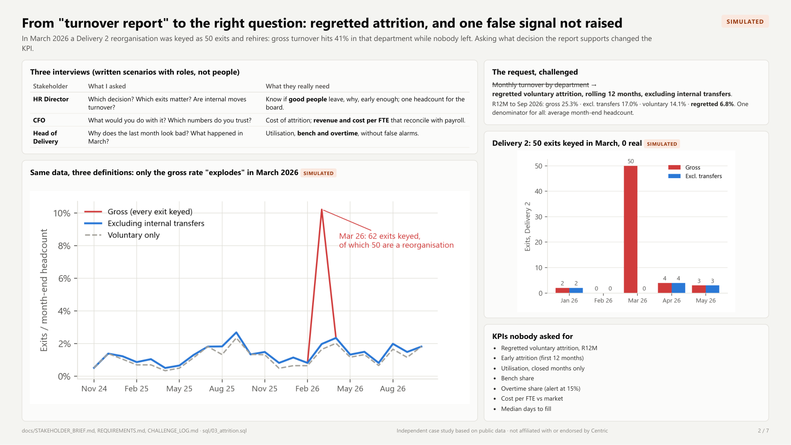

# Centric: from an HR director's request to a Power BI model

**Workforce analytics for an IT services company: an independent BI Analyst case study.**

> The company analysed here is a **fictional 600-person IT services company** with offices in Kaunas and Vilnius.
> All HR, timesheet, recruiting and finance data are **SIMULATED** (seed 42). Stakeholder interviews are **written scenarios** with roles,
> not people. Public data (**PUBLIC DATA**: Eurostat, Statistics Lithuania, Nager.Date) calibrate the simulation and feed a `Market` table.
> Nothing here is Centric data, and no Centric client or employee is described.

| Deliverable | Link |
|---|---|
| 8-page PDF case study | [docs/Centric_BI_Workforce_Case_Study.pdf](docs/Centric_BI_Workforce_Case_Study.pdf) |
| Interactive dashboard (no Power BI needed, download and open) | [dashboard/workforce_dashboard.html](dashboard/workforce_dashboard.html) |
| Power BI project (PBIP: TMDL model + PBIR report) | [powerbi/CentricWorkforce.pbip](powerbi/CentricWorkforce.pbip) · [all measures](powerbi/measures.dax) |
| Analysis notebook | [notebooks/analysis.ipynb](notebooks/analysis.ipynb) |
| SQL (DuckDB) | [sql/](sql/) |
| Requirements and design documents | [docs/](docs/) (list below) |



## From the request to the solution, in six steps

The HR Director asked: *"I need a monthly turnover report by department."*

1. **Clarify the request**: three 30-minute interviews (HR Director, CFO, Head of Delivery) to find the decision behind it → [STAKEHOLDER_BRIEF.md](docs/STAKEHOLDER_BRIEF.md)
2. **Document the needs**: user stories, acceptance criteria, MoSCoW priorities, what is out of scope → [REQUIREMENTS.md](docs/REQUIREMENTS.md)
3. **Challenge it**: "turnover" had no shared definition, and a reorganisation keyed as exit + rehire made March 2026 look like a crisis → [CHALLENGE_LOG.md](docs/CHALLENGE_LOG.md)
4. **Propose KPIs nobody asked for**: regretted attrition, early attrition, utilisation on closed months, bench, overtime, cost per FTE vs market, time to fill → [KPI_DICTIONARY.md](docs/KPI_DICTIONARY.md)
5. **Build the model**: SQL checks, star schema, 51 DAX measures, Power Query with a `DataFolder` parameter, row-level security, 22 KPIs checked against SQL → [DATA_MODEL.md](docs/DATA_MODEL.md), [KPI_CHECKS.md](docs/KPI_CHECKS.md), [DATA_ISSUES_LOG.md](docs/DATA_ISSUES_LOG.md)
6. **Present and drive adoption**: one-page read-out, 30-minute training, release notes, usage tracking, a plan for when nobody opens it → [ADOPTION_PLAN.md](docs/ADOPTION_PLAN.md)

## Four key results (SIMULATED)

1. **A false signal not raised.** Delivery 2 shows 50 exits in March 2026; all 50 people were rehired the next day under the same id. Excluding internal transfers: 0. The headline KPI became **regretted voluntary attrition, rolling 12 months, excluding internal transfers** (6.8% to September 2026, against 25.3% gross).
2. **Overload, then exits.** Data & Cloud overtime stayed above 15% of capacity for four months; regretted resignations then doubled (0.56 → 1.17 a month), with *workload / burnout* as the first reason. An overtime alert now flags it early.
3. **Pay compression.** Like-for-like raises +2.8% vs +3.7% for the Lithuanian ICT labour cost index (PUBLIC DATA); new hires earn 6-10% more than colleagues with 2-4 years of service; resignations at that tenure went from 7% to 18% a year.
4. **One set of numbers.** An HRIS migration duplicated 18 ids (+3% headcount) and finance mapped a cost centre to the wrong department for three months. The HR-to-finance bridge now closes to zero every month; the open month is reported only once timesheets are in (cut-off rule).

## Power BI project

`powerbi/CentricWorkforce.pbip` opens in Power BI Desktop. The semantic model is plain text (TMDL): 5 fact tables, 4 dimensions,
a disconnected `Market` table (PUBLIC DATA), 18 single-direction relationships (one inactive, used with `USERELATIONSHIP`),
51 measures in display folders with descriptions (time intelligence, `DIVIDE`, variables, `TREATAS`, `KEEPFILTERS`), and a
`DepartmentManager` RLS role. The four report pages (Executive overview, Attrition deep dive, Utilization & bench,
Data quality & reconciliation) are written in PBIR by `src/build_report_pages.py`.

**Status:** the PBIP is generated and checked by script (every field used by the pages exists in the model; every KPI matches SQL
with the same logic on the same tables). **It has not yet been opened in Power BI Desktop**, so the report pages are not verified
visually; [POWERBI_BUILD_GUIDE.md](docs/POWERBI_BUILD_GUIDE.md) describes each visual to rebuild it by hand if needed, and
[measures.dax](powerbi/measures.dax) holds every measure. The HTML dashboard shows the same four pages.

## How to rerun everything

Python 3.10+ and Microsoft Edge (or Chrome) for the PDF.

```
pip install -r requirements.txt
python src/fetch_public.py            # PUBLIC DATA -> data/public (Eurostat, Statistics Lithuania, Nager.Date)
python src/simulate_company.py        # SIMULATED extracts -> data/sim (seed 42)
python src/run_sql.py                 # sql/01..06 + kpi_checks.sql in DuckDB -> data/output
jupyter nbconvert --to notebook --execute --inplace notebooks/analysis.ipynb
python src/export_model_tables.py     # star schema -> data/model + docs/KPI_CHECKS.md
python src/build_pbip.py              # Power BI project (TMDL model, measures.dax, report shell)
python src/build_report_pages.py      # Power BI report pages (PBIR)
python src/build_dashboard.py         # dashboard/workforce_dashboard.html
python src/build_pdf.py               # docs/Centric_BI_Workforce_Case_Study.pdf
```

Then open `powerbi/CentricWorkforce.pbip` and, if the repository is not in `C:\case-study-centric`, set the **`DataFolder`**
parameter (*Transform data > Edit parameters*) to the full path of `data\model\`. No API key, no account, no LLM call: everything
reruns as is.

## Repository

```
src/        fetch_public, simulate_company, run_sql, export_model_tables, build_pbip, build_report_pages, charts, build_dashboard, build_pdf
sql/        01_data_quality, 02_headcount_fte, 03_attrition, 04_utilization, 05_compensation_market, 06_hr_finance_reconciliation, kpi_checks
data/       public/ (PUBLIC DATA) · sim/ (SIMULATED extracts) · output/ (SQL results) · model/ (tables loaded by Power BI)
powerbi/    CentricWorkforce.pbip, .SemanticModel (TMDL), .Report (PBIR), measures.dax
docs/       PDF, requirements and design documents, img/
dashboard/  workforce_dashboard.html
notebooks/  analysis.ipynb
```

## Methods

- **Simulation** (`src/simulate_company.py`): 600 people on average, 6 departments (Delivery 1-3, Data & Cloud, Sales, Support functions),
  2 sites, 5 grades, 24 months (Nov 2024 - Oct 2026), extract dated 6 Nov 2026. SCD2 employee history, movements with exit type and
  regretted flag, monthly timesheets with entry dates, absences, requisitions, finance by cost centre.
- **Calibration with public data**: market pay growth from the Eurostat ICT labour cost index; time to fill from the Eurostat ICT job
  vacancy rate; capacity from Lithuanian public holidays.
- **Eight events were planted and listed before the analysis** (overload, pay compression, a weak hiring cohort, a project loss, an HRIS
  migration, a mis-mapped cost centre, late timesheets, and one false signal), then found from the data alone. The list itself is not
  published, so the analysis can be reproduced blind.
- **Accuracy**: every KPI has a SQL reference (`sql/kpi_checks.sql`) and is recomputed from the model tables with the DAX logic
  (`docs/KPI_CHECKS.md`: 22 / 22 match).
- **AI note.** AI-assisted workflow: I used Claude, mainly to write scripts faster. I drove the project: I defined the questions, chose and validated the data sources, made the analytical decisions and checked every result.

## Sources and terms

| Source | Data | Retrieved | Terms |
|---|---|---|---|
| [Centric, About Centric](https://centric.eu/en/about-centric/) | Company facts, as stated by Centric | 19 Nov 2026 | Quoted, not reused |
| BI Analyst job ad, Kaunas ([LinkedIn](https://www.linkedin.com/jobs/view/4462429556/), [careers.centric.eu](https://careers.centric.eu/lt/vacancies/bi-analyst-op-2025474435/)) | Job requirements, as stated by Centric | 19 Nov 2026 | Quoted, not reused |
| [Eurostat](https://ec.europa.eu/eurostat) `lc_lci_r2_q`, `jvs_q_nace2`, `isoc_sks_itspt` | ICT labour cost index, job vacancy rate, ICT specialists | 19 Nov 2026 | Eurostat reuse policy (free reuse, source acknowledged) |
| [Statistics Lithuania](https://osp.stat.gov.lt) `S3R0050_M3060315_1` | Average monthly earnings by activity | 19 Nov 2026 | Official statistics, source acknowledged |
| [Nager.Date](https://date.nager.at) | Lithuanian public holidays 2024-2026 | 19 Nov 2026 | Free public API |

## Limits

- **All internal data are simulated**: the findings show the method, not facts about Centric.
- The interviews are written scenarios; real stakeholders would bring constraints this case cannot show.
- Sodra open employer data (`atvira.sodra.lt`) refused automated access (HTTP 403): not used, not bypassed.
- Public series lag (earnings and vacancies end in 2025-Q4): the latest published quarter is used and dated.
- The Power BI project has not yet been opened in Power BI Desktop (see status above).

---
Independent case study based on public data · not affiliated with or endorsed by Centric
