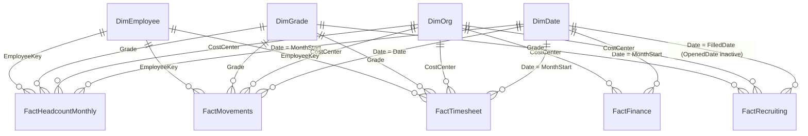

# Data model

Power BI project in text format (PBIP): `powerbi/CentricWorkforce.pbip`. Semantic model in TMDL:
`powerbi/CentricWorkforce.SemanticModel/definition/`. Data: CSV files in `data/model/` (SIMULATED, plus PUBLIC DATA in `Market`),
written by `src/export_model_tables.py`. Generated by `src/build_pbip.py`.

## Star schema



`Market` (PUBLIC DATA, quarterly) is **disconnected** on purpose: measures reach it with `TREATAS` / `LASTNONBLANKVALUE` on the quarter,
so that a missing public quarter never filters company data. `SecurityUserDepartment` is a hidden table used by RLS. `_Measures` holds
all 51 measures in seven display folders.

## Tables

| Table | Grain | Rows | Key | Notes |
|---|---|---:|---|---|
| FactHeadcountMonthly | person × month employed | 14,772 | MonthStart + EmployeeId | From the SCD2 history; flags `IsActiveMonthEnd`, `IsDuplicateId`, `IsNewHireInMonth`; `CapacityHours` (LT working days × 8 × FTE − absences). |
| FactMovements | movement (hire, exit, transfer) | 566 | MovementId | `ExitType`, `ExitReason`, `IsRegretted`, `IsVoluntary`, `IsInternalTransfer`, `TenureMonths`, `TenureBand`. |
| FactTimesheet | person × month, as received on 6 Nov 2026 | 14,366 | MonthStart + EmployeeId | Billable, non-billable, bench, overtime hours; `EntryLagDays`; `LoggedHours` added in Power Query. |
| FactFinance | cost centre × month (closed months) | 276 | MonthStart + CostCenter | Revenue, payroll and other cost, payroll headcount; `DepartmentReported` = finance mapping (kept to show the issue). |
| FactRecruiting | requisition | 244 | RequisitionId | Opened, filled, start date, days to fill, status. |
| DimDate | day, Nov 2024 - Oct 2026 | 730 | Date | Marked as date table. Lithuanian holidays, `IsWorkingDay`, `WorkingDaysInMonth`, `IsClosedMonth` (cut-off), `IsFinanceClosedMonth`. |
| DimEmployee | SCD2 row | 2,734 | EmployeeKey (`id|valid_from`) | Ids only, no names. `MasterEmployeeId` maps duplicates to the real person. |
| DimOrg | cost centre (department × site) | 12 | CostCenter | Department, site, division, `IsBillable`; `OrgUnit` added in Power Query. RLS here. |
| DimGrade | grade | 5 | Grade | G1 Junior to G5 Manager. |
| Market | quarter | 18 | Quarter | PUBLIC DATA: Eurostat labour cost index and job vacancy rate (ICT), ICT specialists share; Statistics Lithuania earnings. |

## Relationships

All many-to-one, **single direction** (dimension filters fact), 18 in total. One **inactive** relationship:
`FactRecruiting[OpenedDate] → DimDate[Date]`, used by `[Requisitions Opened]` through `USERELATIONSHIP`.
Facts are joined to `DimEmployee` on the SCD2 row valid at the time of the fact (month end, or the movement date), so a person who
changes department is counted in the right department each month. Department, site and grade are also stored on the fact row and
filtered through `DimOrg` and `DimGrade`, which keeps the model a star (no snowflake through `DimEmployee`).

## Key DAX patterns

- **Snapshot measures** (`Headcount`, `FTE`, `Average Gross Salary`): take the last month in context with
  `VAR _m = MAX ( DimDate[MonthStart] )`, then `CALCULATE ( ..., REMOVEFILTERS ( DimDate ), DimDate[MonthStart] = _m )`.
- **Rates over a period** divide by `[Average Headcount] = AVERAGEX ( VALUES ( DimDate[MonthStart] ), [Headcount] )`.
- **Time intelligence**: `DATESINPERIOD ( DimDate[Date], MAX ( DimDate[Date] ), -12, MONTH )` for R12M, `SAMEPERIODLASTYEAR` for last year.
- **Cut-off**: `CALCULATE ( [Utilization %], KEEPFILTERS ( DimDate[IsClosedMonth] = 1 ) )` keeps the month on the axis and blanks it if open.
- **Finance mapping**: `TREATAS ( VALUES ( DimOrg[Department] ), FactFinance[DepartmentReported] )` shows the export "as reported".

## Power Query

Each table reads `DataFolder & "<table>.csv"` (UTF-8, quoted CSV), promotes headers and sets types with the `en-US` culture.
Extra steps: `LoggedHours` (FactTimesheet), `OrgUnit` (DimOrg), missing `Site` → "Unknown" (DimEmployee).
The parameter **`DataFolder`** defaults to `C:\case-study-centric\data\model\`: change it under *Transform data > Edit parameters*.

## Row-level security

Role **`DepartmentManager`** (`roles/DepartmentManager.tmdl`):

```dax
DimOrg[Department] = LOOKUPVALUE ( SecurityUserDepartment[Department],
                                   SecurityUserDepartment[UserPrincipalName], USERPRINCIPALNAME () )
```

The same rule applies to `DimEmployee`. The mapping table holds placeholder accounts (`head.delivery1@company.example`...) to replace
with real users or an Entra ID group. Test: *Modeling > View as > DepartmentManager* + *Other user* = `head.datacloud@company.example`.
`Market` is public and not filtered.
